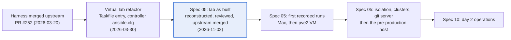

# Board orientation

The Board's "Where we are" panel, read by `docs/board/seed.py`. Redraw it when a spec closes, the direction changes or a big decision lands.

## Here

The lab is built but unproven, and it now carries upstream's latest role.

- **Spec 05, the virtual lab as built: ACTIVE.** Reconstructed from the code on 2026-11-02. Its review is a Claude Doc awaiting your sign-off; no lab run has a recorded result yet.
- **Upstream merged.** `upstream/master` (`750c071`) is merged into `feature/virtual-lab`. Upstream changed nothing under `testing/`, so the Taskfile entry point and the controller-first design are unchanged.
- **Spec 10, day 2 operations: DRAFT.** It waits for spec 05.

## Goals

| Goal | Where it stands | Next |
| --- | --- | --- |
| **A virtual lab, not just a test runner**: log into a controller and operate a Splunk estate as in production | The controller, its `ansible.cfg` and web terminal are built; the `prod` topology installs Splunk but forms no clusters | Clusters and the git server (spec 05 tasks 2.1, 2.3) |
| **Stay current with upstream without its bash-first harness** | Upstream role merged; the lab's Taskfile design kept; `run-tests.sh` only forwards to `task` | Run the lab against the merged role (task 2.7) |
| **Run it on real lab hosts** | Built and used on macOS only | The pve2 VM first, then the pre-production host after isolation fixes (tasks 3.x) |
| **Teach Molecule** | Teaching doc with the spec 05 review | Your comments on the doc |

## Roadmap

## Why

The fork exists to turn the upstream role's Molecule harness into a virtual lab: a controller you log into and drive like production, with Molecule only building and tearing down the estate. The harness merged upstream in March and was refactored back to that intent on `feature/virtual-lab`, but never run on record. Spec 05 writes down what was built, so the next step is evidence, not new features.

## Next

- **Now, spec 05:**
    - Sign off the review (Claude Doc, linked on the spec's Review tab).
    - Run `MOLECULE_ENV=small task workflow:full` on the Mac and record it (tasks 1.1, 1.2).
    - Cheap correctness fixes: tasks 2.2, 2.5, 2.6, 3.8.
- **Then:** record the pve2 VM's facts and run there (3.1, 3.2); isolation before the pre-production host (3.3, 3.4, 3.6, 3.9).
- **Then:** clusters and Gitea (2.1, 2.3), which spec 10 needs.
