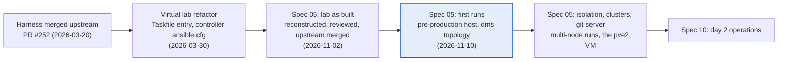

# Board orientation

The Board's "Where we are" panel, read by `docs/board/seed.py`. Redraw it when a spec closes, the direction changes or a big decision lands.

## Here

The lab runs and checks itself on three of its four topologies; the fourth, `prod`, passes its infrastructure stage and has both clusters verified in half-size tests, but its eleven containers have never run together. That run needs a machine with about 40 GB of free container disk; the work Mac's shared disk filled during the attempts on 2026-11-18, so no more Splunk installs run there.

- **Spec 05, the virtual lab as built: ACTIVE.** Reconstructed from the code on 2026-11-02. Its review (the "Review of spec 05" tab) awaits your sign-off. It first ran on 2026-11-10 and 11-11, on the pre-production host, as the one-node `dms` topology.
- **Upstream merged.** `upstream/master` (`750c071`) is merged into the lab branch, now `main` and the fork's default branch. Upstream changed nothing under `testing/`, so the Taskfile entry point and the controller-first design are unchanged.
- **2026-11-18, on the Mac.** `small`, `dev` and `dms` pass full workflows; every stage's check was shown to fail on its fault; `prod` passes infra with a working Git server; day0 forms the indexer cluster and the search head cluster (each verified in a half-size lab). 11 of spec 05's tasks remain open, all needing another machine, more disk or an answer from you. Records: `docs/history/verification-2026-11-18-*.md`; the day's decisions: `docs/decisions/2026-11-18-02-lab-behaviour-changes.md`.
- **Spec 10, day 2 operations: DRAFT.** It waits for spec 05.

## Goals

| Goal | Where it stands | Next |
| --- | --- | --- |
| **A virtual lab, not just a test runner**: log into a controller and operate a Splunk estate as in production | The controller works with no flags and runs the runner's Ansible; `small`, `dev` and `dms` have full recorded runs, and every stage's check was shown to fail on its fault; `prod` passes infra with a Git server that holds its app repositories; day0 forms the indexer cluster and the search head cluster, each verified in a half-size lab | `prod` end to end on a machine with about 40 GB of free container disk (2.1, 1.3) |
| **Stay current with upstream without its bash-first harness** | Upstream role merged and run in the lab on `small`, `dev` and `dms`; the Taskfile design kept; `run-tests.sh` only forwards to `task`; the lint hook, which crashed upstream too, works again | Exercise the role's app deployment from the Git server (spec 10) |
| **Run it on real lab hosts** | `dms` ran on the pre-production host under root Podman. For a shared host: ports bind to loopback, the Git server refuses sign-up, the controller has no Docker socket, SSH takes keys only, lab names that already resolve are refused, images use names Podman resolves, and day0 checks free disk first | The pve2 VM's facts and a run there (3.1, 3.2); the lab on Podman with the new image names (3.12); the pre-production host (3.9); two labs on one engine (3.7) |
| **Teach Molecule** | The "Learn Molecule through the lab" tab in this doc | Lesson 1 in progress |

## Roadmap

## Why

The fork exists to turn the upstream role's Molecule harness into a virtual lab: a controller you log into and drive like production, with Molecule only building and tearing down the estate. The harness merged upstream in March and was refactored back to that intent on `feature/virtual-lab`, but never run on record. Spec 05 writes down what was built, so the next step is evidence, not new features.

## Next

- **Needs you:** two questions (the Needs you panel above, `docs/decisions/2026-11-18-03-host-name-and-site-names.md`) and the sign-off on the review (the "Review of spec 05" tab).
- **Next run, on a machine with its own container engine and about 40 GB free:** `prod` end to end (2.1, 1.3), a whole day0 behind the new disk check (6.7), and memory and CPU per topology (5.5).
- **Then, on the lab hosts:** the pve2 VM's facts and a run there (3.1, 3.2); the lab on Podman with the new image names (3.12); the pre-production host (3.9).
- **Design work with no run needed:** two labs on one engine (3.7).
- **After spec 05:** spec 10, day 2 operations, which can now use the Git server's repositories.
