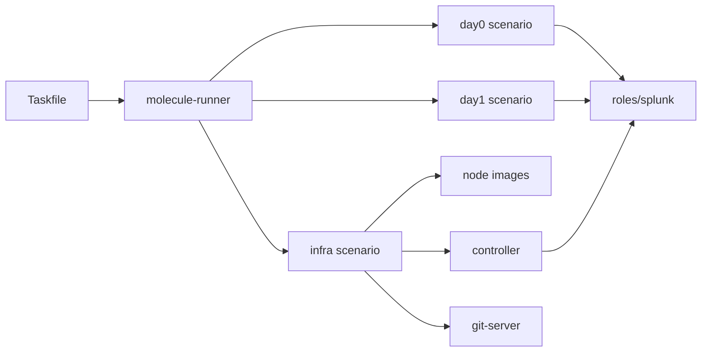

# Feature matrix: the virtual lab

Legend: ✅ done · 🟡 partial · ❌ missing or broken · ⏳ planned · — not involved. A cell marked ✅ means the code does it; the Verified column says whether a run has shown it. Task references point at `docs/specs/05-molecule-virtual-lab/tasks.md` (the fork has no issue tracker).

## Lab capabilities (spec 05)

| Feature | Taskfile | runner | infra | day0 | day1 | controller | git-server | Verified | Spec | Tasks |
|---|---|---|---|---|---|---|---|---|---|---|
| lab-setup | ✅ | ✅ download.yml | — | — | — | — | — | one run: Mac, 2026-11-18 (same record); the second, skip-everything run of 1.1 is not recorded | 05 | 1.1, 2.6 |
| lab-topologies | ✅ `MOLECULE_ENV` | ✅ | ✅ small/dev/dms/prod | ✅ | ✅ | ✅ | — | `small` and `dev` run on the Mac 2026-11-18; `dms` on the pre-production host 2026-11-10; `prod` not run | 05 | 1.3 |
| lab-infra | ✅ | ✅ | ✅ prepare stops on a missing secret; verify checks systemd and SSH from the controller | — | — | ✅ | — | run: Mac, `small`, 2026-11-18 ([record](../history/verification-2026-11-18-small-topology.md)); both checks also shown to fail | 05 | 1.2, 2.2, 6.2 |
| lab-day0-install | ✅ | ✅ | — | 🟡 installs, then forms the indexer cluster and search head cluster on a clustered topology; verify fails on a dead unit, a closed port or a missing cluster member; `prod` as a whole not yet run | — | ✅ runnable | — | run: Mac, `small`, 2026-11-18 ([record](../history/verification-2026-11-18-small-topology.md)); verify also shown to fail; indexer cluster formed in a three-node half ([record](../history/verification-2026-11-18-cluster-formation.md)) | 05 | 1.2, 2.1, 6.1 |
| lab-day1-ops | ✅ | ✅ | — | — | ✅ restart, status, licence; verify asserts active and prints diagnostics on failure | — | — | run: Mac, `small`, 2026-11-18 ([record](../history/verification-2026-11-18-small-topology.md)); verify also shown to fail | 05 | 1.2, 6.3, 6.4 |
| lab-controller | — | — | ✅ prepare | — | — | 🟡 works with no flags; apt Ansible differs from runner | — | run: Mac, `dev`, 2026-11-18 ([record](../history/verification-2026-11-18-dev-topology-and-operator-path.md)) | 05 | 1.4, 2.4 |
| lab-web-terminal | ✅ diag:terminal | — | ✅ | — | — | ✅ ttyd + nginx, password checked; 🟡 open on all interfaces | — | login 200 / 401: Mac, `dev`, 2026-11-18 (same record) | 05 | 1.5, 3.3 |
| lab-git-server | — | — | ✅ starts | 🟡 probes only | — | — | ❌ no repos, users or key | no recorded run | 05 | 2.3 |
| lab-cleanup | ✅ reset | — | ✅ destroy removes containers and node volumes | 🟡 destroy.yml unused | — | — | ✅ | run: Mac, `small`, 2026-11-18, two full runs in a row ([record](../history/verification-2026-11-18-small-topology.md)) | 05 | 5.2, 6.5 |

> [!warning] Built, not verified
> Every row above. No lab run has a recorded result, and the work Mac has none of the lab images (2026-11-02). Tasks 1.1–1.5 produce the first records.

> [!warning] Known gaps
> - `prod` names a cluster manager, two indexer sites, a search head cluster and a deployer, but day0 only installs Splunk; no cluster is formed (task 2.1).
> - The lab has run only on macOS. Isolation on a shared host (published ports, the Docker socket in the controller, privileged nodes, lab names that can match real hosts) is open (tasks 3.3–3.6).

## Day 2 (spec 10, planned)

| Feature | Taskfile | runner | infra | day0 | day1 | day2 | controller | Verified | Spec |
|---|---|---|---|---|---|---|---|---|---|
| day2-git-app-deploy | ⏳ | ⏳ | — | — | — | ⏳ | ⏳ | — | 10 |
| day2-backup-recovery | ⏳ | ⏳ | — | — | — | ⏳ | ⏳ | — | 10 |
| day2-cluster-maintenance | ⏳ | ⏳ | — | — | — | ⏳ | ⏳ | — | 10 |
| day2-advanced-ops | ⏳ | ⏳ | — | — | — | ⏳ | ⏳ | — | 10 |
| day2-multi-env | ⏳ | ⏳ | — | — | — | ⏳ | ⏳ | — | 10 |
| day2-ops-validation | ⏳ | ⏳ | — | — | — | ⏳ | ⏳ | — | 10 |
