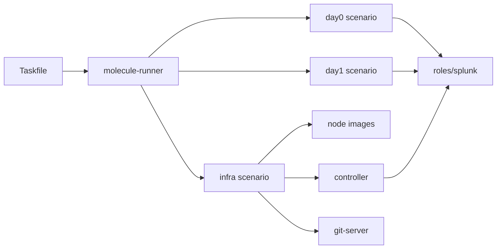

# Feature matrix: the virtual lab

Legend: ✅ done · 🟡 partial · ❌ missing or broken · ⏳ planned · — not involved. A cell marked ✅ means the code does it; the Verified column says whether a run has shown it. Task references point at `docs/specs/05-molecule-virtual-lab/tasks.md` (the fork has no issue tracker).

## Lab capabilities (spec 05)

| Feature | Taskfile | runner | infra | day0 | day1 | controller | git-server | Verified | Spec | Tasks |
|---|---|---|---|---|---|---|---|---|---|---|
| lab-setup | ✅ | ✅ download.yml | — | — | — | — | — | first run on a machine that never had the lab, and a second run that skips: 2026-11-18 ([record](../history/verification-2026-11-18-lab-setup.md)) | 05 | 1.1, 2.6 |
| lab-topologies | ✅ `MOLECULE_ENV` | ✅ | ✅ small/dev/dms/prod | ✅ | ✅ | ✅ | — | `small`, `dev` and `dms` run on the Mac 2026-11-18 (`dms` also on the pre-production host 2026-11-10); `prod` end to end on a second Mac 2026-11-18 ([record](../history/verification-2026-11-18-prod-end-to-end.md)) | 05 | 1.3 |
| lab-infra | ✅ | ✅ | ✅ prepare stops on a missing secret; verify checks systemd and SSH from the controller | — | — | ✅ | — | run: Mac, `small`, 2026-11-18 ([record](../history/verification-2026-11-18-small-topology.md)); both checks also shown to fail | 05 | 1.2, 2.2, 6.2 |
| lab-day0-install | ✅ | ✅ | — | ✅ checks free disk, installs, then forms the indexer cluster and search head cluster on a clustered topology; verify fails on a dead unit, a closed port or a missing cluster member | — | ✅ runnable | — | run: Mac, `small`, 2026-11-18 ([record](../history/verification-2026-11-18-small-topology.md)); verify also shown to fail; indexer cluster and search head cluster each formed and verified in a half-size lab ([record](../history/verification-2026-11-18-cluster-formation.md)), then both in one full `prod` lab ([record](../history/verification-2026-11-18-prod-end-to-end.md)) | 05 | 1.2, 2.1, 6.1, 6.7, 6.9 |
| lab-day1-ops | ✅ | ✅ | — | — | ✅ restart, status, licence; verify asserts active and prints diagnostics on failure | — | — | run: Mac, `small`, 2026-11-18 ([record](../history/verification-2026-11-18-small-topology.md)); verify also shown to fail | 05 | 1.2, 6.3, 6.4 |
| lab-controller | — | — | ✅ prepare | — | — | ✅ works with no flags; same ansible-core and collections as the runner, asserted in infra verify | — | run: Mac, `dev`, 2026-11-18 ([record](../history/verification-2026-11-18-dev-topology-and-operator-path.md)) | 05 | 1.4, 2.4 |
| lab-web-terminal | ✅ diag:terminal | — | ✅ | — | — | ✅ ttyd + nginx, password checked; published on `127.0.0.1` unless `LAB_BIND_ADDRESS` widens it | — | login 200 / 401: Mac, `dev`, 2026-11-18 (same record) | 05 | 1.5, 3.3 |
| lab-git-server | — | — | ✅ starts; prepare creates the owner, key and one seeded repository per app; verify reads each from the controller | 🟡 reports only | — | ✅ has git; clones with the lab key | ✅ six app repositories on `prod` | infra run: Mac, `prod`, 2026-11-18 ([record](../history/verification-2026-11-18-prod-infra-and-git-server.md)); the role deploying the apps is not run | 05 | 2.3 |
| lab-cleanup | ✅ reset | — | ✅ destroy removes containers and node volumes | ✅ a failed day0 or day1 leaves the lab up | — | — | ✅ | run: Mac, `small`, 2026-11-18, two full runs in a row ([record](../history/verification-2026-11-18-small-topology.md)) | 05 | 5.2, 6.5 |

> [!warning] Built, not verified
> `prod` has one full run, on a second Mac, where the lab took 35 GB of engine disk and 6.0 to 6.6 GiB of memory with no data; all four topologies have measured memory and disk ([record](../history/verification-2026-11-18-memory-and-disk-per-topology.md)). The search head cluster losing a member has been shown only in the half-size lab. The role deploying apps from the Git server has no run behind it (day 2, spec 10). Rows with a run name their record; `small` and `dev` ran on the Mac on 2026-11-18.

> [!warning] Known gaps
> - `prod`'s clusters are the smallest that form (two peers, two members). The indexer cluster is single-site, and no licence manager is configured: the lab has no licence file, so every node runs on a trial licence.
> - The lab's full runs are all on macOS (two machines); `dms` alone ran on Linux under Podman. Published ports bind to `127.0.0.1`, the Git server refuses sign-up and the controller has no Docker socket (tasks 3.3, 3.4). Infra refuses lab names that already resolve outside the lab (3.6). Nodes stay privileged by decision, and through them the role changes the host's huge-pages setting (3.5). A lab can be named (`LAB_NAME`, `LAB_PORT_OFFSET`), and three labs ran on one engine at once ([record](../history/verification-2026-11-18-two-labs-on-one-engine.md), 3.7).

## Day 2 (spec 10, planned)

| Feature | Taskfile | runner | infra | day0 | day1 | day2 | controller | Verified | Spec |
|---|---|---|---|---|---|---|---|---|---|
| day2-git-app-deploy | ⏳ | ⏳ | — | — | — | ⏳ | ⏳ | — | 10 |
| day2-backup-recovery | ⏳ | ⏳ | — | — | — | ⏳ | ⏳ | — | 10 |
| day2-cluster-maintenance | ⏳ | ⏳ | — | — | — | ⏳ | ⏳ | — | 10 |
| day2-advanced-ops | ⏳ | ⏳ | — | — | — | ⏳ | ⏳ | — | 10 |
| day2-multi-env | ⏳ | ⏳ | — | — | — | ⏳ | ⏳ | — | 10 |
| day2-ops-validation | ⏳ | ⏳ | — | — | — | ⏳ | ⏳ | — | 10 |
