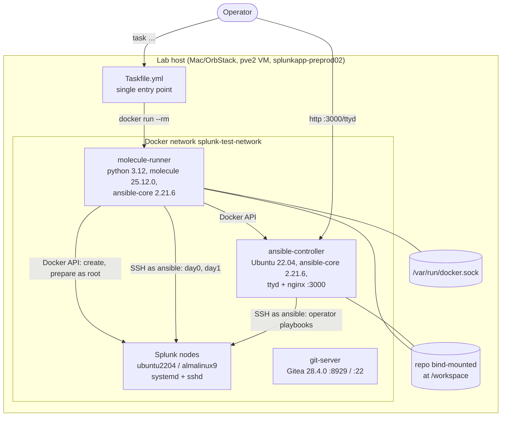
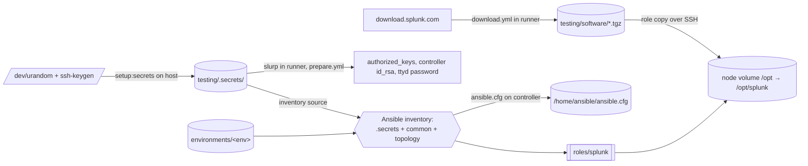
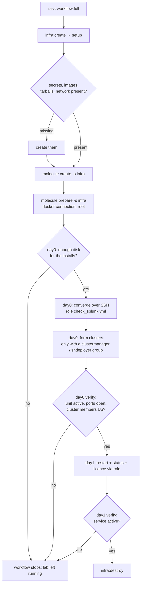
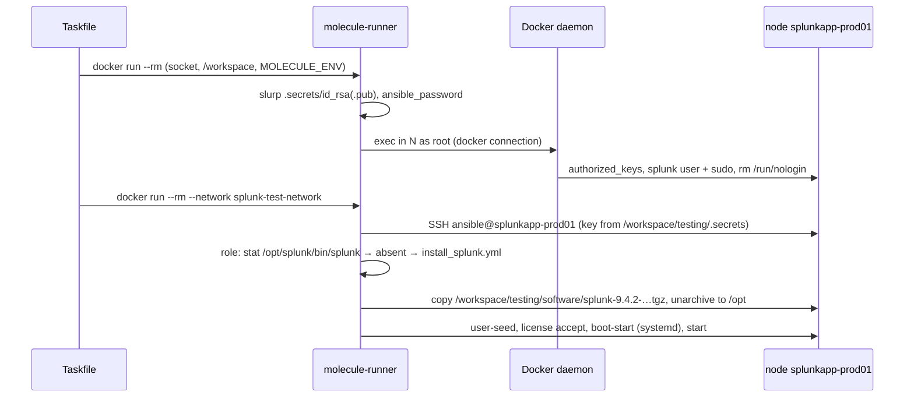

# Design: Molecule virtual lab (first written from `6ff020f`; kept current with `main`)

## End-To-End Walkthrough

`task workflow:full` with `MOLECULE_ENV=small`, traced through the code:

1. `infra:setup` → `infra:create` → `setup` (`Taskfile.yml:47`): secrets, images, `download:splunk` (runs `molecule/download.yml` in a throwaway runner, writes `testing/software/splunk-9.4.2-…tgz`), network. (`mol-run`, the persistent runner, starts only when `task runner:shell` is used.)
2. `molecule create -s infra` in a `--rm` runner with the host Docker socket and the repo at `/workspace` (`_MOL`, `Taskfile.yml:36`). `infra/create.yml` starts `ansible-controller`, then one container per host in `full` and `uf` from that host's `docker_image`, each with a named volume `ansible-splunk-test-<host>-data` on `/opt`.
3. `molecule prepare -s infra`: `infra/prepare.yml` reads the key and password inside the runner, then over the **docker** connection as root writes `authorized_keys`, creates the `splunk` user with sudo, clears `/run/nologin`, and configures the controller (keys, `ansible.cfg`, ttyd unit, nginx).
4. `day0:test` → `molecule test -s day0` in a runner joined to `splunk-test-network` (`_MOL_NET`), so names like `splunkapp-prod01` resolve to containers. `day0/converge.yml` first checks that the engine's disk can hold the pending installs plus a margin and stops if not, then applies the role with `deployment_task: check_splunk.yml` over **SSH** as `ansible`, then, on a topology that has a `clustermanager` or `shdeployer` group, runs the role's cluster tasks (manager, peers, search heads, deployer, search head cluster members, captain). Because `splunk_download_local: true`, the role's `download_and_unarchive.yml` finds the tarball already in `splunk_package_path` on localhost (the runner), copies it to each node and unpacks it.
5. `day0/verify.yml` asserts that the `Splunkd`/`SplunkForwarder` unit is active and ports 8089/8000 answer, waits for every indexer to be an Up peer of the manager and every search head cluster member to be Up where those groups exist, and reports whether Gitea answers (informational).
6. `day1:test` applies the role twice (`splunk_restart.yml`, `check_splunk_status.yml`); `day1/verify.yml` asserts the service is `active`.
7. `infra:destroy` removes the controller, the nodes with their `/opt` data volumes, and git-server. The Gitea volume and the network stay until `task reset`.

## Components And Boundaries

Names in this document are those of the unnamed lab, the default. A lab started with `LAB_NAME=<name>` has the same parts under its own names: containers `<name>-<host>`, the network `splunk-test-network-<name>`, volumes `ansible-splunk-lab-<name>-…` (the stem is `lab-<name>`, not `test`, so one lab's `task reset` cannot match another's volumes), and its three published ports moved by `LAB_PORT_OFFSET`. Inside its network every container keeps its inventory name as hostname and alias, so everything below holds for a named lab as written (task 3.7).



| Component | Responsibility | Defined in |
|---|---|---|
| Taskfile | Entry point, ordering, Docker run flags, veth fix in the runner | `testing/Taskfile.yml` |
| molecule-runner | Runs Molecule; creates containers through the host socket; runs the role in scenarios | `docker-images/molecule-runner/Dockerfile` |
| Node images | systemd PID 1, `ps`, sshd and scp, user `ansible` with NOPASSWD sudo, a boot-time unit that turns checksum offload off on `eth0` | `docker-images/{ubuntu2204,almalinux9}-systemd-sshd/` |
| Controller image | Node image plus ansible-core 2.21.6 in a Python 3.12 virtualenv (the runner's version and collections), ttyd 1.7.7 (built from source), nginx proxy on 3000 | `docker-images/ansible-controller/Dockerfile` |
| git-server | Gitea 28.4.0 on SQLite, port 8929; infra prepare creates an owner, the lab key and one seeded repository per app in `git_apps` | `docker-images/git-server/Dockerfile` |
| Topologies | Hosts, groups, versions, cluster vars | `molecule/environments/*` |
| Secrets | Lab key, ttyd password, Splunk admin password, Gitea key | generated in `testing/.secrets/` |

## APIs And Interfaces

| Surface | Signature | Does | Called by |
|---|---|---|---|
| `task setup` | env `MOLECULE_ENV` | secrets, images, downloads, network | operator; `infra:test`, `infra:create` |
| `task setup:secrets` / `setup:images` / `setup:rebuild` / `download:splunk` / `network:create` | — | the setup steps one by one | `setup` |
| `task infra:test` | `MOLECULE_ENV` | `molecule test -s infra` (destroy, create, prepare, verify, destroy) | operator |
| `task infra:create` / `infra:prepare` / `infra:setup` / `infra:destroy` | `MOLECULE_ENV` | one infra stage; `setup` = create + prepare; `create` runs `lab:ports` first | operator, workflows |
| `task lab:ports` | `LAB_NAME`, `LAB_PORT_OFFSET`, `MOLECULE_ENV` | stops when the web terminal's port, or on a topology with a Git server one of its two ports, is already in use and this lab's own container is not the one holding it | `infra:create`, operator |
| `task day0:test` / `day0:converge` / `day0:verify` | `MOLECULE_ENV` | install stage | operator, workflows |
| `task day1:test` / `day1:converge` / `day1:verify` | `MOLECULE_ENV` | operations stage | operator, `workflow:full` |
| `task workflow:full` / `workflow:quick` | `MOLECULE_ENV` | chained stages | operator |
| `task diag:terminal` / `diag:ssh` / `status` / `shell -- <name>` | — | inspection; both `diag:*` exit non-zero when the lab is unhealthy | operator |
| `task runner:start` / `runner:shell` / `runner:stop` | — | persistent `mol-run`, started on demand by `runner:shell` | operator |
| `task reset` | — | destroy, stop runner, remove any container still on the lab's network (a lab built from another topology), its volumes and the network | operator |
| `day0/converge.yml`, `day0/verify.yml` | run from runner or controller | role install; checks | Molecule, operator |
| `http://<host>:3000/ttyd` | basic auth `ansible:<password>` | web shell as `ansible` on the controller | operator |
| `http://<host>:8929`, `ssh -p 2222` | Gitea | one repository per app in `git_apps`, at `ssh://git@git-server/test/<app>`, created and seeded by infra | infra verify; the role's `splunk_apps` tasks (not yet run in the lab) |

## Dataflow



Each store has one writer: `.secrets/` is written only by `setup:secrets` (created if absent, never rotated); `software/` only by `download.yml`; node `/opt` volumes only by the role; `ansible.cfg` only by `prepare.yml`. Node volumes are removed with their node by `infra:destroy`, so each new lab installs Splunk afresh; a second day0 on a running lab takes the role's "already installed" branch.

## Change Map

```text
testing/
  Taskfile.yml                      entry point (about 360 lines)
  run-tests.sh                      forwards to task
  requirements.yml                  galaxy collections (ranges)
  docker-images/
    molecule-runner/Dockerfile      python 3.12.16-slim (by digest) + molecule 25.12.0 + ansible-core 2.21.6, all pinned
    ubuntu2204-systemd-sshd/        node base
    almalinux9-systemd-sshd/        node base + sshd/PAM overrides for containers
    ansible-controller/             node base + pinned ansible-core + ttyd 1.7.7 + nginx
    git-server/Dockerfile           Gitea 28.4.0 by digest, sign-up off, accepts the lab's RSA 2048 key
  molecule/
    download.yml                    tarball fetch
    infra/{molecule,create,prepare,verify,destroy}.yml
    day0/{molecule,converge,verify}.yml + inventory/ (repeats common SSH settings)
    day1/{molecule,converge,verify}.yml
    tasks/splunk_diagnostics.yml    printed by day0 and day1 verify for a node whose Splunk is down
    environments/{common,small,dev,dms,prod}/hosts.yml + group_vars/
```

## Workflow



## Key Interactions

Prepare, then install on one node:



Operator path from the controller (R6): operator → `:3000/ttyd` (nginx → ttyd on 127.0.0.1:7681) → bash as `ansible` with `ANSIBLE_CONFIG=/home/ansible/ansible.cfg` → `ansible-playbook` over SSH with `~/.ssh/id_rsa` to the same nodes.

## Algorithms

Container creation (`infra/create.yml`). Before it, `task infra:create` runs `task lab:ports`, which stops when the lab's controller does not exist yet and the web terminal's port, or one of the Git server's two ports on a topology that has one, is already in use on the machine:

```text
targets = groups.full + groups.uf + groups.git_server + groups.ansible_controller
ensure network splunk-test-network
if 'ansible_controller' in groups:
    run controller (privileged, cgroupns=host, /workspace, .secrets ro, publish 3000 on the bind address)
for host in targets minus git-server, ansible-controller:
    run host from hostvars[host].docker_image or ubuntu2204
        (privileged, cgroupns=host, /sys/fs/cgroup rw, volume ansible-splunk-test-<host>-data:/opt)
if 'git_server' in groups:
    run gitea (publish 2222, 8929; volume ansible-splunk-test-gitea-data)
sleep 10
```

Install decision (`roles/splunk/tasks/check_splunk.yml`, role code the lab drives):

```text
if not exists {splunk_home}/bin/splunk: install_splunk.yml   # download/copy, seed, license, boot-start
configure_license.yml
if splunk_auditd_configure: configure_auditd.yml
if installed before this run and installed version < splunk_package_version:
    stop if running; upgrade_splunk.yml
```

`install_splunk.yml` does not include any cluster task (`configure_idxc_*`, `configure_shc_*`); the role forms clusters through separate task files, which `day0/converge.yml` runs after the install in the order of `playbooks/splunk_idxc_deploy.yml` and `playbooks/splunk_shc_deploy.yml`. The peer, search-head, member and captain tasks are not idempotent in the role, so converge checks each node first and skips one already configured.

## State And Data Lifecycle

| Store | Writer | Authority | Reader | Retention | Reproducible |
|---|---|---|---|---|---|
| `testing/.secrets/` | `setup:secrets` | yes | runner, controller (ro mount) | until deleted by hand; synced by Dropbox in this checkout | regenerated if absent |
| `testing/software/` | `download.yml` | derived | role via `splunk_package_path` | until deleted | yes, from download.splunk.com |
| volumes `ansible-splunk-test-<host>-data` | role on nodes | lab state | nodes | removed with their node by `infra:destroy` (a volume without its container's systemd unit fails the role's boot-start check) | rebuilt by day0 |
| `ansible-splunk-test-gitea-data` | Gitea, and infra prepare through its API | lab state | Gitea | kept by `infra:destroy`; removed by `reset` | recreated by infra prepare (owner, key, repositories) |
| images `*:latest` | `setup:images` | derived | Docker | until `setup:rebuild` | yes for bases, Python packages, collections and tools (pinned by tag and digest or exact version); operating-system packages from `apt` and `dnf` are not pinned |

## Failure And Recovery

- A failed stage stops the workflow and leaves containers up for debugging; `task infra:destroy` or `task reset` cleans up.
- `infra:destroy` removes the hosts of the topology `MOLECULE_ENV` names when it runs. A lab built as `prod` and destroyed as `small` keeps its other nodes; `task reset` removes them, because it clears whatever is left on the lab's network.
- The container engine publishes a port that another program already holds without an error, and that program then answers on it. `task lab:ports` catches this for the web terminal's port before the lab is created; on a topology with a Git server it probes that server's two ports as well.
- Destroy removes containers with `state: absent`, which passes when a container is already gone, so a partly created lab still tears down; a removal that really fails now fails the destroy (it was ignored before 2026-11-18).
- The veth offload fix is applied once per runner command, and on every node and the controller by a systemd unit at each boot, so it survives a container or host restart.
- Download retries 3 times, 10 s apart.

## Verification

Recorded runs: all four topologies in full, 2026-11-18: `small`, `dev` and `dms` on the first Mac, `prod` end to end on a second Mac with its own engine, after its two cluster halves on the first (`docs/history/verification-2026-11-18-*.md`); `dms` on the pre-production host, 2026-11-10 (tasks Log). Checks the harness itself contains: `infra/prepare.yml` (lab secrets exist), `infra/verify.yml` (systemd is PID 1 on each node over the docker connection, and the controller reaches every node over SSH), `day0/verify.yml` (unit active, ports open, cluster members Up), `day1/verify.yml` (asserts the service is active and prints diagnostics for a node that is not). Verification tasks are in `tasks.md`.

## Security

| Boundary | As built |
|---|---|
| Operator → controller | ttyd basic auth over plain HTTP on `127.0.0.1:3000` unless `LAB_BIND_ADDRESS` widens it; password random, 20 chars |
| Controller → host | privileged container (it runs systemd) with no Docker socket since 2026-11-18; `ansible` has NOPASSWD sudo, so the ttyd password grants root inside a privileged container, which can still reach the host's devices (task 3.5) |
| Nodes → host | privileged, `cgroupns_mode: host`, `/sys/fs/cgroup` rw. Privileged is kept on purpose (decision 7 of 2026-11-18): without it the role's huge-pages unit fails. With it, that unit changes the setting for the whole host |
| Network → Gitea | `127.0.0.1:8929` and `:2222` unless `LAB_BIND_ADDRESS` widens them; sign-up refused; one owner created by infra |
| Inside the lab | sshd on the nodes and the controller accepts keys only (since 2026-11-18). The `ansible` user's password is still the fixed word baked into the images, and that user has passwordless sudo, so a shell on a node is root on it; host keys are not checked between lab hosts |
| Name resolution | lab hosts carry production-style names (`splunkapp-prod01`, `splunkshc-prod01`, …). `infra/create.yml` refuses to build the lab when any of those names already resolves outside it. Inside a running lab, a name whose container is down still falls through Docker's DNS to the host's resolver, so the refusal covers the start of a lab, not a network that begins answering for a lab name later |

These are acceptable on a laptop and are the open questions for `splunkapp-preprod02` (tasks 3.x).

## Decisions

- [2026-11-02-01-adopt-spec-layout](../../decisions/2026-11-02-01-adopt-spec-layout.md)
- [2026-11-18-01-main-default-branch.md](../../decisions/2026-11-18-01-main-default-branch.md): the lab branch is `main` and the fork's default branch.
- [2026-11-18-02-lab-behaviour-changes.md](../../decisions/2026-11-18-02-lab-behaviour-changes.md): seven agent decisions on teardown, failure handling, the controller's Ansible, clusters, verify, the Git server and privileged nodes.
- [2026-11-18-03-host-name-and-site-names.md](../../decisions/2026-11-18-03-host-name-and-site-names.md): open; two owner questions.

## As Built

Reconstructed from the code, compared with the README and requirements:

| Requirement | As built | State |
|---|---|---|
| R1 setup | As specified. Images are checked with `docker image inspect`, built under `localhost/<name>:latest`, and every base and tool is pinned; a second `task setup` skips every step | ✅ run on both Macs, the second of which had never had the lab |
| R2 topologies | `small` 2 nodes, `dev` 1, `dms` 1, `prod` 9 + git-server; AlmaLinux on `splunkapp-prod02`, `splunkshc-prod02` | ✅ all four run in full |
| R3 infra | As specified; `infra/verify.yml` pings every node from the controller over SSH | ✅ run on `small`, `dev`, `dms` and `prod` (nine nodes) |
| R4 day0 | As specified. Checks free disk, installs Splunk, forms a two-peer indexer cluster and a two-member search head cluster where the topology has them, and verify fails on a fault. The cluster is single-site and no licence file is installed (every node runs on a trial licence); `splunk-uf01` is a deployment client of `splunk-fwdmanager`, read back from both ends | ✅ run on `small`, `dev`, `dms` and `prod` |
| R5 day1 | As specified, plus licence acceptance after the restart and diagnostics on failure | ✅ run on `small`, `dev`, `dms` and `prod` |
| R6 controller | As specified. The controller and the runner pin the same ansible-core (2.21.6) and collections, and infra verify asserts it | ✅ run on `small`, `dev`, `dms` and `prod` infra |
| R7 web terminal | As specified; login 200 with the password, 401 without | ✅ run on `dev` |
| R8 git server | As specified: infra creates the owner, installs the lab key, and creates and seeds one repository per app in `git_apps`; infra verify reads each from the controller | ✅ infra run on `prod` |
| R9 workflows | As specified; `mol-run` starts only for `task runner:shell`; a failed `day0:test` or `day1:test` leaves the lab running (`--destroy=never`); before 2026-11-18 Molecule ran `day0/destroy.yml` on a failed day0 and deleted the lab; `task reset` removes a lab whichever topology built it and leaves another lab on the engine alone | ✅ run on two Macs |
| R10 portability | Run on macOS (Docker under OrbStack, on two machines) and, for `dms`, on the pre-production host under root Podman. Images are named `localhost/<name>` so both engines resolve them. `LAB_NAME` and `LAB_PORT_OFFSET` give a lab its own container names, network, volumes and ports, so several labs share one engine | 🟡 the containers are created on Podman with today's code, but no full run yet on a Linux Docker host or on the pre-production host (3.2, 3.9) |

## Architect's Review

Written at close through `/spec-review 05-molecule-virtual-lab` as a Claude Doc and folded in after Kun signs it off.
