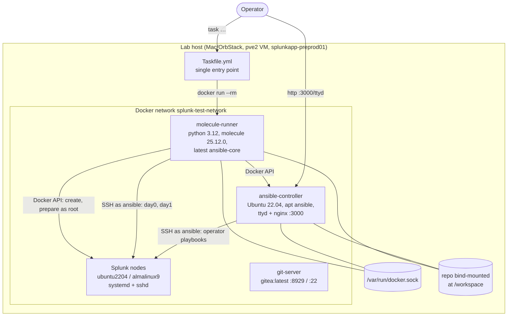
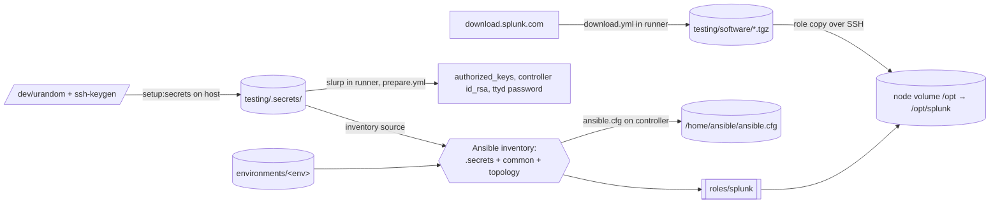
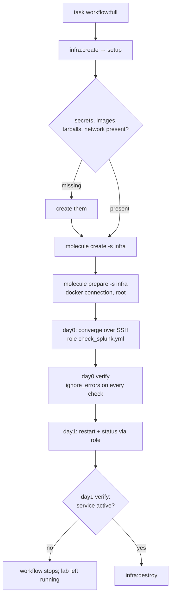
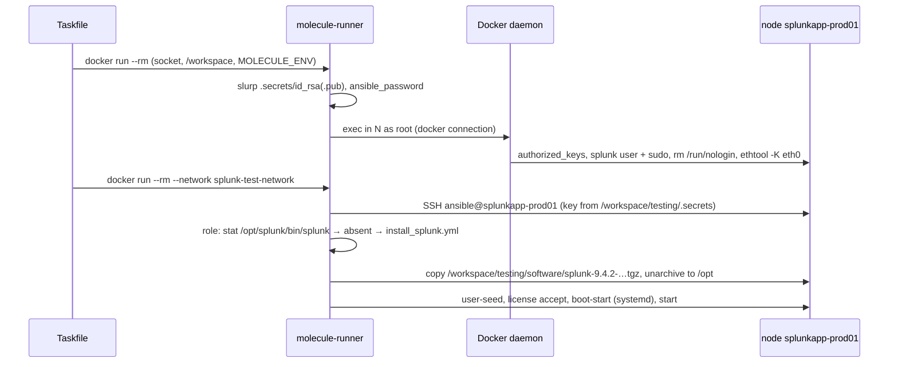

# Design: Molecule virtual lab (as built at `6ff020f`)

## End-To-End Walkthrough

`task workflow:full` with `MOLECULE_ENV=small`, traced through the code:

1. `infra:setup` → `infra:create` → `setup` (`Taskfile.yml:47`): secrets, images, `download:splunk` (runs `molecule/download.yml` in a throwaway runner, writes `testing/software/splunk-9.4.2-…tgz`), network, `runner:start` (`mol-run`, left running).
2. `molecule create -s infra` in a `--rm` runner with the host Docker socket and the repo at `/workspace` (`_MOL`, `Taskfile.yml:36`). `infra/create.yml` starts `ansible-controller`, then one container per host in `full` and `uf` from that host's `docker_image`, each with a named volume `ansible-splunk-test-<host>-data` on `/opt`.
3. `molecule prepare -s infra`: `infra/prepare.yml` reads the key and password inside the runner, then over the **docker** connection as root writes `authorized_keys`, creates the `splunk` user with sudo, clears `/run/nologin`, and configures the controller (keys, `ansible.cfg`, ttyd unit, nginx).
4. `day0:test` → `molecule test -s day0` in a runner joined to `splunk-test-network` (`_MOL_NET`), so names like `splunkapp-prod01` resolve to containers. `day0/converge.yml` applies the role with `deployment_task: check_splunk.yml` over **SSH** as `ansible`. Because `splunk_download_local: true`, the role's `download_and_unarchive.yml` finds the tarball already in `splunk_package_path` on localhost (the runner), copies it to each node and unpacks it.
5. `day0/verify.yml` checks the `Splunkd`/`SplunkForwarder` units and ports 8089/8000 with `ignore_errors`, prints cluster and SHC status with `failed_when: false`, and probes Gitea.
6. `day1:test` applies the role twice (`splunk_restart.yml`, `check_splunk_status.yml`); `day1/verify.yml` asserts the service is `active`.
7. `infra:destroy` removes the controller, nodes and git-server. Volumes and the network stay until `task reset`.

## Components And Boundaries



| Component | Responsibility | Defined in |
|---|---|---|
| Taskfile | Entry point, ordering, Docker run flags, veth fix in the runner | `testing/Taskfile.yml` |
| molecule-runner | Runs Molecule; creates containers through the host socket; runs the role in scenarios | `docker-images/molecule-runner/Dockerfile` |
| Node images | systemd PID 1, sshd, user `ansible` with NOPASSWD sudo | `docker-images/{ubuntu2204,almalinux9}-systemd-sshd/` |
| Controller image | Node image plus apt `ansible`, ttyd 1.7.7 (built from source), nginx proxy on 3000 | `docker-images/ansible-controller/Dockerfile` |
| git-server | Gitea on SQLite, port 8929 | `docker-images/git-server/Dockerfile` |
| Topologies | Hosts, groups, versions, cluster vars | `molecule/environments/*` |
| Secrets | Lab key, ttyd password, Splunk admin password, Gitea key | generated in `testing/.secrets/` |

## APIs And Interfaces

| Surface | Signature | Does | Called by |
|---|---|---|---|
| `task setup` | env `MOLECULE_ENV` | secrets, images, downloads, network, `mol-run` | operator; `infra:test`, `infra:create` |
| `task setup:secrets` / `setup:images` / `setup:rebuild` / `download:splunk` / `network:create` | — | the setup steps one by one | `setup` |
| `task infra:test` | `MOLECULE_ENV` | `molecule test -s infra` (destroy, create, prepare, verify, destroy) | operator |
| `task infra:create` / `infra:prepare` / `infra:setup` / `infra:destroy` | `MOLECULE_ENV` | one infra stage; `setup` = create + prepare | operator, workflows |
| `task day0:test` / `day0:converge` / `day0:verify` | `MOLECULE_ENV` | install stage | operator, workflows |
| `task day1:test` / `day1:converge` / `day1:verify` | `MOLECULE_ENV` | operations stage | operator, `workflow:full` |
| `task workflow:full` / `workflow:quick` | `MOLECULE_ENV` | chained stages | operator |
| `task diag:terminal` / `diag:ssh` / `status` / `shell -- <name>` | — | inspection; both `diag:*` print instead of failing | operator |
| `task runner:start` / `runner:shell` / `runner:stop` | — | persistent `mol-run` | operator, `setup` |
| `task reset` | — | destroy, stop runner, remove `ansible-splunk-test-*` volumes and the network | operator |
| `day0/converge.yml`, `day0/verify.yml` | run from runner or controller | role install; checks | Molecule, operator |
| `http://<host>:3000/ttyd` | basic auth `ansible:<password>` | web shell as `ansible` on the controller | operator |
| `http://<host>:8929`, `ssh -p 2222` | Gitea | app repositories (none created) | `prod` `git_apps` (unused, see Gaps) |

## Dataflow



Each store has one writer: `.secrets/` is written only by `setup:secrets` (created if absent, never rotated); `software/` only by `download.yml`; node `/opt` volumes only by the role; `ansible.cfg` only by `prepare.yml`. Node volumes survive `infra:destroy` and are reused by the next `infra:create`, so a second day0 on the same volumes takes the role's "already installed" branch.

## Change Map

```text
testing/
  Taskfile.yml                      entry point (304 lines)
  run-tests.sh                      forwards to task
  requirements.yml                  galaxy collections (ranges)
  docker-images/
    molecule-runner/Dockerfile      python:3.12-slim + molecule 25.12.0 + unpinned tools
    ubuntu2204-systemd-sshd/        node base
    almalinux9-systemd-sshd/        node base + sshd/PAM overrides for containers
    ansible-controller/             node base + apt ansible + ttyd 1.7.7 + nginx
    git-server/Dockerfile           gitea:latest
  molecule/
    download.yml                    tarball fetch
    infra/{molecule,create,prepare,verify,destroy}.yml
    day0/{molecule,converge,verify,destroy}.yml + inventory/ (repeats common SSH settings)
    day1/{molecule,converge,verify}.yml
    environments/{common,small,dev,prod}/hosts.yml + group_vars/
```

## Workflow



## Key Interactions

Prepare, then install on one node:



Operator path from the controller (R6): operator → `:3000/ttyd` (nginx → ttyd on 127.0.0.1:7681) → bash as `ansible` with `ANSIBLE_CONFIG=/home/ansible/ansible.cfg` → `ansible-playbook` over SSH with `~/.ssh/id_rsa` to the same nodes.

## Algorithms

Container creation (`infra/create.yml`):

```text
targets = groups.full + groups.uf + groups.git_server + groups.ansible_controller
ensure network splunk-test-network
if 'ansible_controller' in groups:
    run controller (privileged, cgroupns=host, docker.sock, /workspace, .secrets ro, publish 3000)
for host in targets minus git-server, ansible-controller:
    run host from hostvars[host].docker_image or ubuntu2204
        (privileged, cgroupns=host, /sys/fs/cgroup rw, volume ansible-splunk-test-<host>-data:/opt)
if 'git_server' in groups:
    run gitea (publish 2222, 8929; volume ansible-splunk-test-gitea-data)
sleep 10
```

Install decision (`roles/splunk/tasks/check_splunk.yml`, role code the lab drives):

```text
if not exists {splunk_home}/bin/splunk: install_splunk.yml   # download/copy, seed, license, boot-start
configure_license.yml
if splunk_auditd_configure: configure_auditd.yml
if installed before this run and installed version < splunk_package_version:
    stop if running; upgrade_splunk.yml
```

`install_splunk.yml` does not include any cluster task (`configure_idxc_*`, `configure_shc_*`); clustering is done by `playbooks/splunk_idxc_deploy.yml` and `playbooks/splunk_shc_deploy.yml`, which no scenario runs.

## State And Data Lifecycle

| Store | Writer | Authority | Reader | Retention | Reproducible |
|---|---|---|---|---|---|
| `testing/.secrets/` | `setup:secrets` | yes | runner, controller (ro mount) | until deleted by hand; synced by Dropbox in this checkout | regenerated if absent |
| `testing/software/` | `download.yml` | derived | role via `splunk_package_path` | until deleted | yes, from download.splunk.com |
| volumes `ansible-splunk-test-<host>-data` | role on nodes | lab state | nodes | survive `infra:destroy`; removed by `reset` | rebuilt by day0 |
| `ansible-splunk-test-gitea-data` | Gitea | lab state | Gitea | same | empty on rebuild |
| images `*:latest` | `setup:images` | derived | Docker | until `setup:rebuild` | no: bases and tools unpinned |

## Failure And Recovery

- A failed stage stops the workflow and leaves containers up for debugging; `task infra:destroy` or `task reset` cleans up.
- Destroy steps use `ignore_errors`, so a partly created lab still tears down.
- The veth offload fix is applied once per runner command and once per node in prepare; nothing reapplies it after a container restart.
- Download retries 3 times, 10 s apart.

## Verification

Recorded runs: none. The work Mac has no lab images (`docker images`, 2026-11-02). Checks the harness itself contains: `infra/verify.yml` (systemd is PID 1 on each node, over the docker connection), `day0/verify.yml` (informational), `day1/verify.yml` (asserts the service is active). Verification tasks are in `tasks.md`.

## Security

| Boundary | As built |
|---|---|
| Operator → controller | ttyd basic auth over plain HTTP on `0.0.0.0:3000`; password random, 20 chars |
| Controller → host | privileged container with `/var/run/docker.sock` mounted (`:ro` does not limit API calls); `ansible` has NOPASSWD sudo, so the ttyd password grants root on the lab host |
| Nodes → host | privileged, `cgroupns_mode: host`, `/sys/fs/cgroup` rw |
| Network → Gitea | `0.0.0.0:8929` and `:2222`, `DISABLE_REGISTRATION=false` |
| Inside the lab | password `ansible:ansible` baked into images, `PermitEmptyPasswords yes`, PAM `account sufficient pam_permit.so` on AlmaLinux; host keys not checked |
| Name resolution | lab hosts carry production-style names (`splunkapp-prod01`, `splunkshc-prod01`, …) that can match real hosts on a work network; a lab name with no running container falls through Docker's DNS to the host's resolver and its search domain |

These are acceptable on a laptop and are the open questions for `splunkapp-preprod01` (tasks 3.x).

## Decisions

- [2026-11-02-01-adopt-spec-layout](../../decisions/2026-11-02-01-adopt-spec-layout.md)

## As Built

Reconstructed from the code, compared with the README and requirements:

| Requirement | As built | State |
|---|---|---|
| R1 setup | All steps present. Image check `docker images \| grep -q name:latest` matches only on Docker CLIs that print `repo:tag` in one column (the work Mac's CLI does; older CLIs print `REPOSITORY TAG` columns, so the check never passes and every `setup` rebuilds) | 🟡 |
| R2 topologies | `small` 2 nodes, `dev` 1, `prod` 9 + git-server; AlmaLinux on `splunkapp-prod02`, `splunkshc-prod02` | ✅ code |
| R3 infra | Containers and keys done; `infra/verify.yml` does not test SSH from the controller | 🟡 |
| R4 day0 | Installs and starts Splunk; no cluster is formed, so the `prod` cluster manager, sites, SHC and deployer exist in name only; verify cannot fail | 🟡 |
| R5 day1 | As specified | ✅ code |
| R6 controller | `ansible.cfg` deployed; the controller runs Ubuntu 22.04's apt `ansible` while the runner runs the latest `ansible-core` from pip, so the two paths use different Ansible versions (exact controller version not yet read from a built image) | 🟡 |
| R7 web terminal | As specified | ✅ code |
| R8 git server | Gitea starts; no repositories, users or deploy key are created (`prepare.yml:310` placeholders; `git_key: /tmp/test_git_key` never written) | ❌ |
| R9 workflows | As specified; `infra:test` leaves `mol-run` running; `day0/destroy.yml` is never invoked (`destroy_sequence: [cleanup]`) | 🟡 |
| R10 portability | Built and used on macOS only; fixed names and ports allow one lab per Docker host | ⏳ |

## Architect's Review

Written at close through `/spec-review 05-molecule-virtual-lab` as a Claude Doc and folded in after Kun signs it off.
